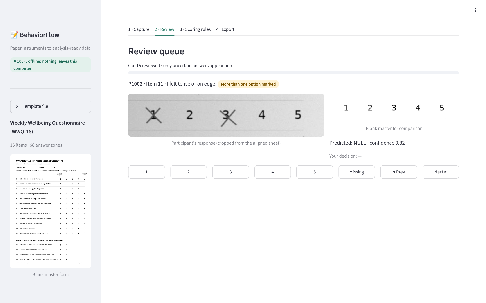

# BehaviorFlow prototype

Team 1114 · 2026 Inter-University GenAI Hackathon for SDGs (Track 4: Future Work & Enterprises).



Reads completed paper questionnaires (Likert, multiple choice, true/false) from scans or phone photos, fully offline, and exports CSV, Excel and SPSS files. Uncertain marks go to a human review queue instead of being guessed.

## Run it

```bash
pip install -r requirements.txt
streamlit run app.py          # opens on http://127.0.0.1:8501, local only
```

Click **Load demo sheets** on the Capture tab to try it with the 12 bundled test sheets. Regenerate the full 100-sheet held-out set with `python3 demo/simulate.py` (see below).

Optional local language model for the rule assistant (otherwise a built-in parser is used):

```bash
# install Ollama from ollama.com, then:
ollama pull qwen2.5:1.5b-instruct
```

## How it works

| Step | File | What it does |
|---|---|---|
| Template | `bf/template.py` | Blank master image + answer zones (JSON) |
| Align | `bf/align.py` | ORB keypoints + RANSAC homography warp any photo onto the master; no corner markers |
| Detect | `bf/detect.py` | New ink per zone minus the printed form; flags blank / multiple / faint / uncertain |
| Rules | `bf/rules.py` | Plain English → JSON rules via a local LLM (Ollama) or offline parser; applied deterministically |
| Export | `bf/export.py`, `bf/pipeline.py` | CSV, XLSX with codebook, SPSS .sav, and one evidence crop per answer |
| App | `app.py` | Capture, review queue, rules, export |

## Test results (synthetic sheets with known answers)

```bash
python3 demo/make_form.py        # demo form + template
python3 demo/simulate.py 40      # 40 tuning sheets
python3 demo/evaluate.py
```

Fresh held-out set of 100 sheets (`demo/heldout/evaluation.json`): 1,600 answers, 0 silent errors, 8.9% sent to review (12% of answers were deliberately messy), 0.49 s per sheet, 70% phone photos.

Limits: test marks are synthetic; real-sheet validation with the thesis-student pilot is next. Templates are currently written as JSON (a zone-drawing screen is on the roadmap). Free-text handwriting is out of scope.

`demo/record_demo.py` re-records the screenshots and demo video in `demo/media/`.
